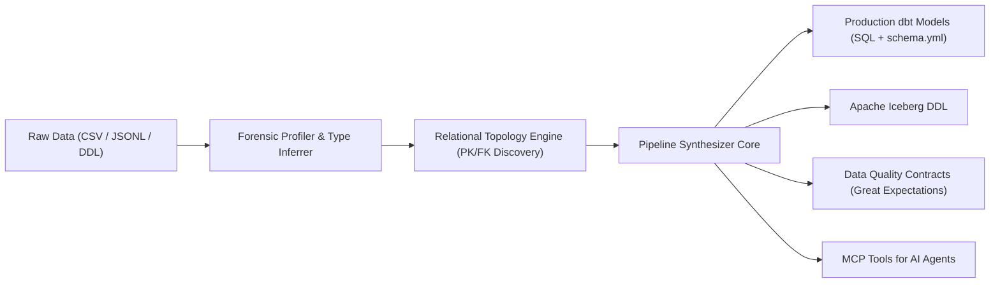

# DEA — Data & Schema Engineering Anything 📊🧊

> **Autonomous Enterprise Data Deconstruction, Relational Topology Inference, and dbt / Iceberg Pipeline Synthesis Engine.**

DEA is an agentic data architect tool. It ingests opaque, legacy, or dirty heterogeneous data sources (CSVs, JSONL dumps, raw database extracts) and automatically discovers **relational topology, primary/foreign key relationships, and data quality contracts**, synthesizing complete **dbt Core projects** and **Apache Iceberg / BigLake lakehouse schemas** with zero manual grunt work.

---

## ⚡ Architecture



---

## 🚀 Key Capabilities

- **Forensic Dataset Profiling**: Computes exact statistics (row count, distinct counts, null ratios, min/max length, regex formats).
- **Automated PK/FK Topology Discovery**: Tests every column for uniqueness and checks candidate child columns for referential containment against parent candidate keys.
- **Production dbt Project Synthesis**:
  - Generates clean staging models with explicit column casting and aliasing.
  - Generates `schema.yml` containing dbt tests (`unique`, `not_null`, `relationships`).
- **Apache Iceberg DDL Generation**: Emits partition-optimized Iceberg table definitions with hidden partitioning and schema evolution readiness.
- **Data Quality Contracts**: Generates declarative expectation suites to guard against data drift.
- **Built-in MCP Server**: Exposes data engineering superpowers to Antigravity, Claude Code, Cursor, and Windsurf.

---

## 🛠️ CLI Usage

### 1. Profile and Inspect Datasets
```bash
npx dea inspect customers.csv orders.csv
```

### 2. Infer Relational Topology (Foreign Keys & Primary Keys)
```bash
npx dea topology customers.csv orders.csv
```

### 3. Generate Complete dbt Project
```bash
npx dea dbt customers.csv orders.csv --output ./my-dbt-project
```

### 4. Run MCP Server
```bash
npx dea mcp
```

---

## 🤖 MCP Tools

| Tool | Description |
|---|---|
| `inspect_data_sources` | Ingests CSV or JSON files and returns exhaustive column profiling statistics. |
| `infer_relational_topology` | Discovers primary keys, foreign key candidate relationships, and cardinality. |
| `generate_dbt_pipeline` | Generates a full dbt directory structure with staging models and test declarations. |
| `generate_data_contracts` | Emits declarative data contracts to enforce schema constraints. |

---

## 📄 License
Apache-2.0
